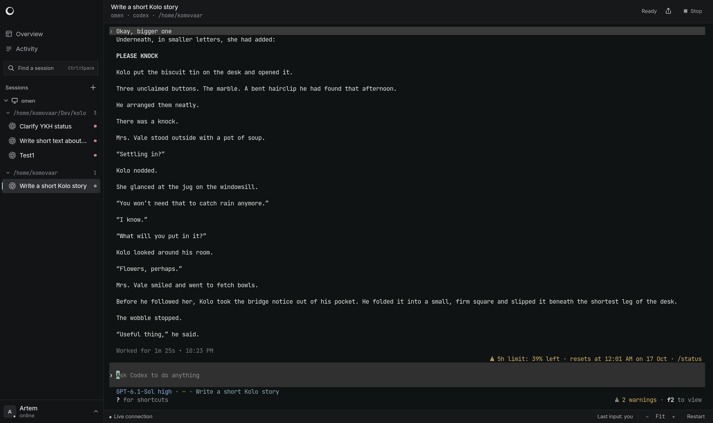

<h1>
  <picture>
    <source media="(prefers-color-scheme: dark)" srcset="web/static/favicon-dark-256.png">
    
  </picture>
  Kolo
</h1>

**Share live AI coding sessions with a link.**

Run Claude Code, Codex, or OpenCode anywhere. Invite anyone into your session instantly, right from their browser.

[](https://github.com/komovaar/kolo/actions/workflows/ci.yml)
[](https://github.com/komovaar/kolo/releases)
[](LICENSE)



## Why Kolo

- **Work in the same session.** Everyone sees the same terminal. Type a prompt,
  approve a step, or pick up where a teammate left off.
- **Bring your terminal agents.** Built-in adapters for Claude Code, Codex CLI,
  and opencode, with custom agent descriptions for other tools.
- **Give observers a seat.** Read-only members can follow along while the host
  decides who can control sessions.

## Quick start

Kolo is an experimental alpha for trusted teams. Agents run with the host user's
permissions. Start in a dedicated VM with only the projects and credentials you
intend to share; see the [isolation setup](SECURITY.md#alpha-isolation-setup).

Install on the machine that will run the agents:

```sh
curl -fsSL https://raw.githubusercontent.com/komovaar/kolo/main/install | KOLO_VERSION=v0.1.0 sh
```

Then open a project and start Kolo:

```sh
cd /path/to/project
kolo up
```

Send your team the invitation link printed in the terminal. They open it in a
browser, choose a name, and join. No install or token to paste.

Hosts support Linux and macOS on amd64 and arm64. Use WSL2 on Windows.
For rolling development builds, replace `v0.1.0` with `nightly`.

## How it works

One Go binary runs the hub your team opens and the host that starts agents.
`kolo up` runs both together. Use `kolo serve` and `kolo host` to run them on
separate machines. Hosts connect out to the hub; the hub needs to be reachable
from your team's browsers.

Kolo detects agent status from terminal output, so CLI updates can affect status
and resume behavior. Run `kolo doctor` to check your setup, and see
[tested versions and limits](docs/alpha-validation.md) for current compatibility.

## Documentation

Start with `kolo help` or `kolo help <command>`.

[Reference](docs/reference.md) · [Security](SECURITY.md) ·
[Contributing](CONTRIBUTING.md) · [Releases](https://github.com/komovaar/kolo/releases)

## License

[AGPL-3.0](LICENSE)
